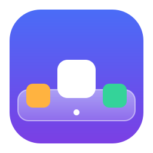
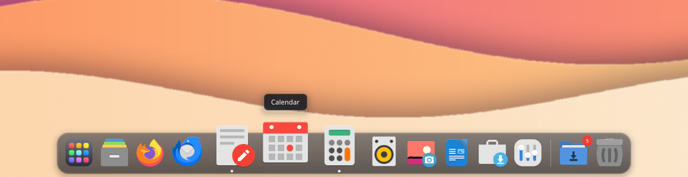
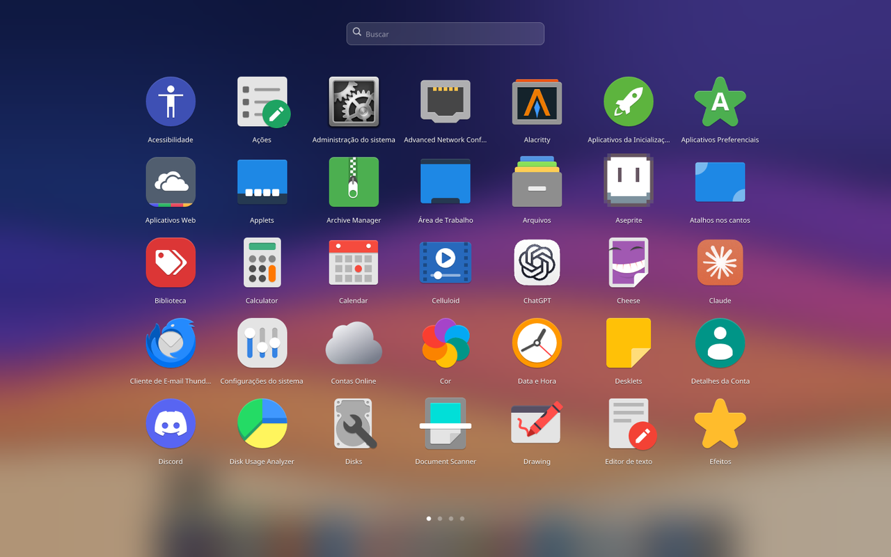
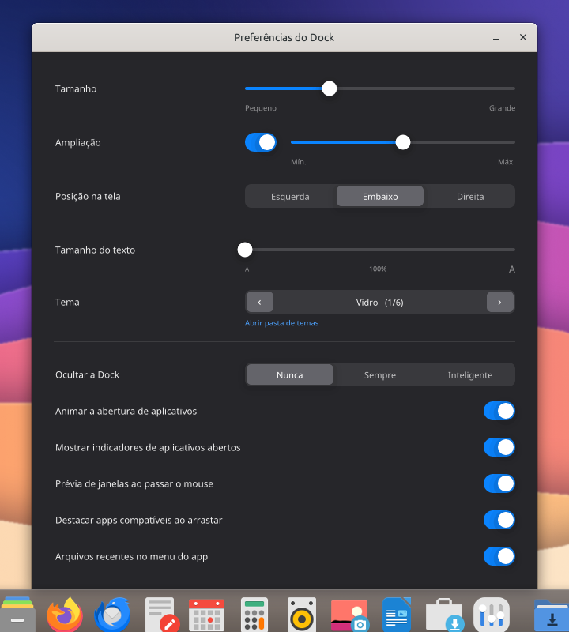
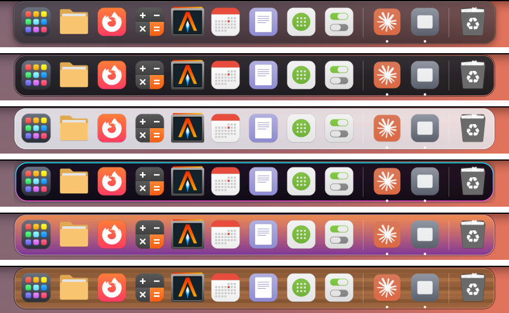
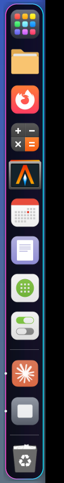

#  rdock

A macOS-style dock for X11 Linux desktops (Cinnamon, XFCE, MATE…), written in pure Rust with no GTK or Qt.



rdock draws everything itself on the CPU with [tiny-skia](https://github.com/RazrFalcon/tiny-skia) and talks to the X server through [x11rb](https://github.com/psychon/x11rb). It reads your installed applications from the standard XDG `.desktop` files and uses your system icon theme.

## Features

- **Fish-eye magnification.** Icons grow along a cosine curve as the pointer approaches, animated with damped springs.
- **Launch bounce.** An icon keeps bouncing until its application's window appears.
- **Running indicators.** A dot appears under every open app. Open apps that aren't pinned show up after a separator, and the dock matches windows to apps by `WM_CLASS`.
- **Click to launch or focus.** Clicking an app launches it, or brings its window to the front if it's already open.
- **Context menus.** Right-click an app for *Open/Show*, *Keep in Dock / Remove from Dock* and *Quit*. Right-click the dock itself for quick toggles and the preferences.
- **Drag & drop.** Drag icons to reorder them while their neighbours slide out of the way. Drag an icon out of the dock to remove it with a "poof". Drag a running app into the pinned area to pin it.
- **Add apps by dragging.** Drag an app out of the Launchpad, or drop a `.desktop` file from your file manager or desktop (XDND), onto the dock to keep it there. It lands where you drop it.
- **Stacks.** Drop a folder on the dock to keep it there. Up to 9 items open as an *orbit*: two arcs around the icon, newest four inside. Larger folders open a *panel* with subfolders, search, sorting (recent, name, kind), a preview pane and full keyboard control (arrows, Enter, Space for a big preview, Backspace to go up, type to filter). A red badge counts files that arrived since you last looked. Folders are watched with inotify, so idle cost stays at 0%. Your Downloads folder is added on first run.
- **Window previews.** Rest the pointer on an open app for 400 ms to see live thumbnails of its windows, with the workspace of each. Click to focus, × to close, the wheel to cycle. Apps with two or more windows show two dots.
- **Drop files on apps.** While you drag a file, the apps that can open it rise and the others fade. Drop on an app to open the file with it, on a stack to move it there (hold Ctrl to copy), or on the Trash to delete it.
- **Recent files in the app menu.** Right-click an app to reopen what it opened last (read from `recently-used.xbel`).
- **Launchpad.** A full-screen grid of every installed app over a blurred copy of the desktop, with a zoom-in animation, sliding pages (mouse wheel, arrow keys or drag) and accent-insensitive search as you type.
- **Trash.** The trash icon shows when the trash has items, and clicking it opens the trash.
- **Three positions:** bottom, left or right of the screen.
- **Hiding.** Never, always (when the pointer leaves), or **smart**: the dock hides only when the active window touches it, like Cinnamon's "intelligently hide" panels.
- **Themes.** A theme is a single PNG (see [Themes](#themes)).
- **Adjustable text size** for the whole interface, from 100% to 180%.
- **Idle cost.** When nothing is animating the dock uses 0% CPU. An animated frame takes about 0.5–2 ms.

### Launchpad



### Preferences and themes

<p>
  
  
  
</p>

Every change applies immediately. Open the preferences in any of these ways:

- right-click the dock shelf, a separator, the Launchpad or the Trash and choose *Preferências do Dock…*;
- open **rdock** from your applications menu (it also starts the dock if it isn't running);
- run:

```bash
rdock --settings
```

> The user interface is currently in Brazilian Portuguese.

## Requirements

- An X11 session with a compositor, because the dock needs a 32-bit ARGB visual for transparency. Cinnamon, XFCE with compositing, and picom all work. Wayland is not supported.
- Rust 1.82 or newer.
- `gio` (from GLib) to launch apps. If it's missing, rdock falls back to `sh -c`.

## Build and run

```bash
cargo build --release
./target/release/rdock
```

On startup rdock installs its icon and an **rdock** entry in your applications menu (`~/.local/share/applications/rdock.desktop`). The entry opens the preferences, and the Launchpad hides it.

If you already run another dock such as Plank, stop it first. Otherwise it will sit on top of rdock at the bottom of the screen.

```bash
pkill plank
```

### Install and start on login

```bash
cargo install --path .
mkdir -p ~/.config/autostart
cat > ~/.config/autostart/rdock.desktop <<EOF
[Desktop Entry]
Type=Application
Name=rdock
Exec=$HOME/.cargo/bin/rdock
X-GNOME-Autostart-enabled=true
X-GNOME-Autostart-Delay=2
EOF
```

## Themes

A theme is **one plain PNG** of the dock shelf, drawn horizontally the way it looks at the bottom of the screen.

- The image is scaled to the shelf's height.
- It is split into three vertical strips. The two ends are **one third of the image height** wide each and stay fixed. The **middle strip is tiled** as the dock grows, so keep rounded corners inside the ends and make the middle tileable: flat colours, vertical gradients or horizontal stripes.
- On the left or right edge the image is rotated automatically, so the bottom of the PNG always faces the screen edge.
- Alpha transparency is respected.

For example, a 180×72 image has 24 px ends, so its corner radius should be about 22 px or less.

Put your PNG in `~/.config/rdock/themes/`. The file name becomes the theme name. Then pick it in *Preferences → Tema*; the *Abrir pasta de temas* link opens that folder. "Vidro" (glass) is the built-in theme.

To install the sample themes from [`themes/`](themes/) (Graphite, Ice, Neon, Sunset, Wood):

```bash
mkdir -p ~/.local/share/rdock/themes && cp themes/*.png ~/.local/share/rdock/themes/
```

## Configuration files

| File | Contents |
|---|---|
| `~/.config/rdock/settings` | Size, magnification, position, hiding, bounce, indicators, text size |
| `~/.config/rdock/pinned` | Pinned apps, one `.desktop` ID per line |
| `~/.config/rdock/theme` | Name of the selected theme |
| `~/.config/rdock/stacks` | Stacks, one per line: `path;style;sort;last-opened` |
| `~/.config/rdock/themes/` | Your theme PNGs |
| `~/.local/share/applications/rdock.desktop` | Menu entry, written by rdock on startup |

On the first run, the pinned list starts with your file manager, browser and terminal, plus your Cinnamon favourites.

## How it works

| File | Role |
|---|---|
| `main.rs` | Event loop, shared state, window → app matching, active-window tracking |
| `dock.rs` | Layout in edge-independent (u, v) coordinates, magnification, bounce, drag & drop, hiding, rendering |
| `launchpad.rs` | App grid, search, paging, screen capture and blur |
| `stack.rs` | Stacks: folder listing, inotify watcher, orbit and panel popovers |
| `previews.rs` | Window preview popover (thumbnails captured on a background thread) |
| `files.rs` | MIME types (shared-mime-info), recent files, `gio` file operations |
| `settings.rs` | Preferences window (sliders, switches, segmented controls) |
| `apps.rs` | `.desktop` parsing, search normalisation, launching via `gio launch` |
| `icons.rs` | XDG icon theme lookup and SVG/PNG rasterisation (background threads) |
| `draw.rs` | Drawing primitives, scaled-icon cache, fast blits, text (ab_glyph) |
| `x.rs` | ARGB windows, shared-memory image upload, EWMH helpers, keyboard map |
| `anim.rs` | Damped springs |
| `config.rs` | Settings, pinned apps and themes on disk |

A few details:

- **Clicks pass through empty areas.** The dock window is fully transparent, and an X Shape input region limits clicks to the shelf. Everywhere else, clicks reach the windows below.
- **Partial redraws.** Each frame clears and uploads only the region that changed.
- **Shared-memory uploads.** Frames reach the X server through MIT-SHM instead of the socket, so the full-screen Launchpad stays at 60 fps. Without SHM (for example over a remote X connection) rdock falls back to `PutImage`.
- **Cached shelf and icons.** The shelf is pre-rendered once and assembled with direct memory copies. Icons are cached at each integer size.
- **Reserved space.** The dock reserves screen space through `_NET_WM_STRUT_PARTIAL`, except when hiding is enabled.

## License

[MIT](LICENSE)
